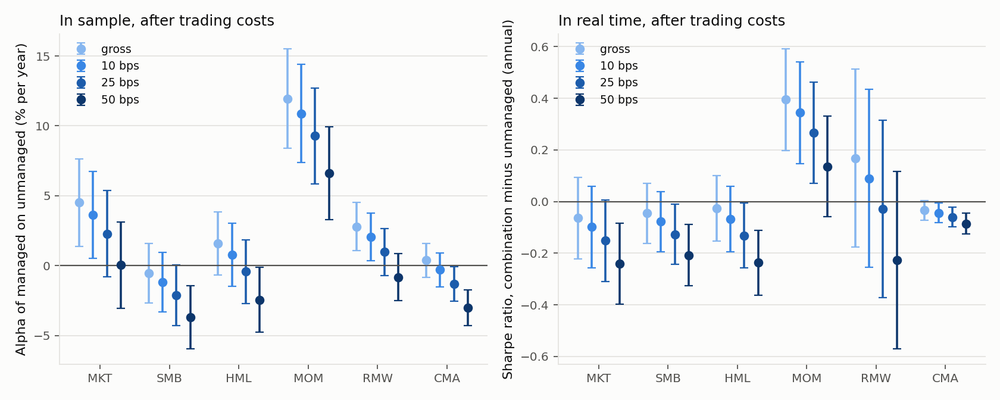
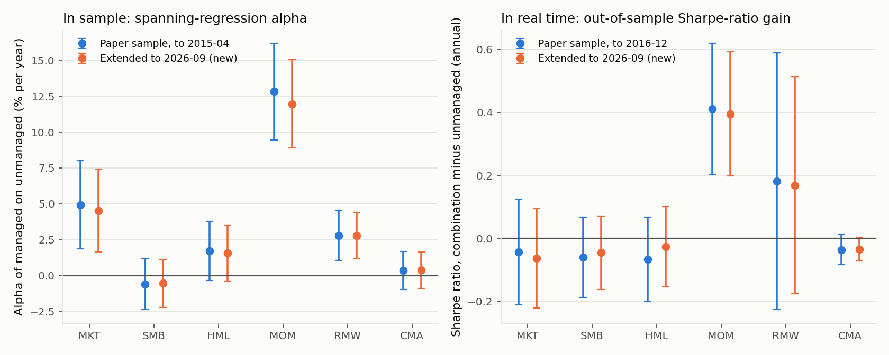

# Ballast

Moreira and Muir (2017) found that scaling a factor by the inverse of last month's variance earns alpha. Cederburg et al. (2020) found that an investor could not have captured it in real time. This repository reproduces both from public data and asks what is left once the extra trading is paid for and the tests allow for fat tails and for testing six factors at once.

## The result

Before costs, the managed factor has a significant in-sample alpha for the market, momentum and profitability (RMW) over 1926 to 2026, with Newey-West t-statistics of 2.82, 6.56 and 3.17. All three survive a Holm correction across the six factors. Scaling trades a lot, though: the position moves by 0.53 to 0.90 of the factor's notional in an average month. At a cost of 10 basis points per unit of that turnover, momentum is the only factor whose alpha stays significant after the Holm correction. The market's alpha reaches zero at 50 bps and RMW's at 39 bps. Momentum's lasts to 112 bps.

In real time, the strategy that can use the managed factor beats the plain factor for two of six: momentum (+0.40 Sharpe, block-bootstrap p = 0.004, Holm p = 0.024) and RMW (+0.17, p = 0.34). Only momentum's gain is significant. Charging both strategies for their own trading, momentum's gain is +0.34 at 10 bps (p = 0.011, Holm p = 0.067) and +0.27 at 25 bps (p = 0.047, Holm p = 0.24), and it reaches zero at 76 bps.



Extended sample, 1926-08 to 2026-09 (real time from 1936-08). Bars are 95% intervals: Newey-West on the left, Jobson-Korkie on the right. Light blue is before costs; darker blues charge 10, 25 and 50 bps per unit of turnover.

The main limit: the cost levels are not estimates of what it costs to trade any of these factors. They are round numbers, and the break-even column lets a reader apply their own estimate. A unit of a long-short factor is a dollar long and a dollar short, so 10 bps per unit is 5 bps on each dollar traded.

### After costs

A unit is one times the factor's notional. A star marks a Holm-adjusted p-value below 0.05 across the six factors at that cost.

In sample, alpha in % a year with the Newey-West t-statistic:

| Factor | Turnover a month | Gross | 10 bps | 25 bps | 50 bps | Break-even (bps) |
|---|---:|---:|---:|---:|---:|---:|
| MKT | 0.74 | 4.51 (2.82)\* | 3.62 (2.28) | 2.28 (1.44) | 0.04 (0.03) | 50 |
| SMB | 0.53 | -0.54 (-0.50) | -1.17 (-1.08) | -2.12 (-1.91) | -3.71 (-3.21)\* | none |
| HML | 0.67 | 1.57 (1.37) | 0.77 (0.67) | -0.43 (-0.37) | -2.44 (-2.05) | 20 |
| MOM | 0.90 | 11.95 (6.56)\* | 10.89 (6.09)\* | 9.28 (5.32)\* | 6.61 (3.91)\* | 112 |
| RMW | 0.60 | 2.79 (3.17)\* | 2.07 (2.38) | 0.98 (1.14) | -0.82 (-0.96) | 39 |
| CMA | 0.56 | 0.38 (0.61) | -0.30 (-0.48) | -1.32 (-2.11) | -3.02 (-4.61)\* | 6 |

In real time, the Sharpe-ratio gain of the combination over the plain factor, with the block-bootstrap p-value. Turnover is the combination's; the plain benchmark trades 0.003 to 0.03 a month.

| Factor | Turnover a month | Gross | 10 bps | 25 bps | 50 bps | Break-even (bps) |
|---|---:|---:|---:|---:|---:|---:|
| MKT | 0.33 | -0.06 [0.53] | -0.10 [0.32] | -0.15 [0.12] | -0.24 [0.01]\* | none |
| SMB | 0.15 | -0.05 [0.53] | -0.08 [0.30] | -0.13 [0.10] | -0.21 [0.01]\* | none |
| HML | 0.30 | -0.03 [0.71] | -0.07 [0.33] | -0.13 [0.06] | -0.24 [0.002]\* | none |
| MOM | 0.71 | +0.40 [0.004]\* | +0.34 [0.01] | +0.27 [0.05] | +0.14 [0.29] | 76 |
| RMW | 0.63 | +0.17 [0.34] | +0.09 [0.62] | -0.03 [0.88] | -0.23 [0.32] | 21 |
| CMA | 0.11 | -0.03 [0.07] | -0.04 [0.03] | -0.06 [0.01] | -0.09 [0.008]\* | none |

The same tables over each paper's own sample and over the months after it are in `results/costs_in_sample.csv` and `results/costs_real_time.csv`. Over the paper samples the break-even costs are within five bps of these.

### Before costs, on each paper's sample



Bars are 95% intervals. Blue is each paper's own sample; orange extends it to September 2026, which neither paper covers.

<table>
<tr>
<th>In sample (1926-08 to 2015-04)</th>
<th>In real time (out of sample, 1936-08 to 2016-12)</th>
</tr>
<tr>
<td valign="top">

| Factor | Alpha (%/yr) | t, White | t, Newey-West | Holm p |
|---|---:|---:|---:|---:|
| MKT | 4.93 | 3.15 | 2.90 | 0.015 |
| SMB | -0.59 | -0.64 | -0.50 | 1.000 |
| HML | 1.73 | 1.64 | 1.41 | 0.472 |
| MOM | 12.83 | 7.47 | 6.49 | 0.000 |
| RMW | 2.80 | 3.14 | 2.96 | 0.015 |
| CMA | 0.36 | 0.53 | 0.57 | 1.000 |

</td>
<td valign="top">

| Factor | Sharpe, with managed | Sharpe, unmanaged | Difference | p, JK | p, bootstrap | Holm p |
|---|---:|---:|---:|---:|---:|---:|
| MKT | 0.42 | 0.46 | -0.04 | 0.62 | 0.67 | 1.00 |
| SMB | 0.13 | 0.19 | -0.06 | 0.36 | 0.45 | 1.00 |
| HML | 0.37 | 0.44 | -0.07 | 0.33 | 0.36 | 1.00 |
| MOM | 0.89 | 0.48 | +0.41 | 0.000 | 0.006 | 0.034 |
| RMW | 0.51 | 0.33 | +0.18 | 0.38 | 0.42 | 1.00 |
| CMA | 0.53 | 0.56 | -0.04 | 0.14 | 0.12 | 0.60 |

</td>
</tr>
</table>

The left table is Moreira and Muir's Table 1, Panel A: regress the managed factor on the unmanaged one. The papers use White (HC0) standard errors; the Newey-West column, with six lags, is added here. It lowers the t-statistics of the three significant alphas (market 3.15 to 2.90, momentum 7.47 to 6.49, RMW 3.14 to 2.96) and changes no verdict at 5%. The Holm p-value uses the Newey-West p-values. MOM starts in 1927-01, RMW and CMA in 1963-08.

The right table is Cederburg et al.'s Table 5, Panel A: a mean-variance investor (risk aversion 5, position capped at 5) estimates the scaling constant and the portfolio weights on an expanding window after 120 months of training. RMW and CMA are scored from 1973-08. "p, JK" is the Jobson-Korkie test the paper uses, which assumes independent normal returns. "p, bootstrap" is a studentised circular block bootstrap in the manner of Ledoit and Wolf (2008), with six-month blocks; it allows fat tails and serial dependence. The Holm p-value adjusts the bootstrap p-values for six tests. The certainty-equivalent (CER) gains are in `results/headline.md`.

## The months nobody had seen

Neither paper covers data after 2016. Over May 2015 to September 2026 (137 months), no managed factor has a significant in-sample alpha even before costs. Three of the six are negative, and momentum's falls to 3.31% a year (Newey-West t = 1.14).

In real time over January 2017 to September 2026 (117 months), momentum's gain is +0.13 (bootstrap p = 0.56). Two factors lose significantly on a single test: HML by 0.10 (Jobson-Korkie p = 0.017, bootstrap p = 0.042) and CMA by 0.02 (p = 0.045 and 0.035). Neither survives the Holm correction (0.21 for both). Both strategies have negative Sharpe ratios for HML and CMA in this window, with or without managing, and the CER differences are +0.06 and -0.02 with p-values near 0.9. Eleven years is too short to say the momentum result has gone, and it is no confirmation either.

## How to reproduce

```
uv sync
uv run python scripts/fetch_data.py
uv run python scripts/reproduce.py
```

The last command rebuilds every table and figure in `results/` in one to three minutes on a desktop. Most of the time goes to the bootstrap (4,999 draws per test) and its size simulation. `uv run python scripts/reproduce.py --fast` runs the same pipeline on seeded synthetic data with a smaller bootstrap, needs no download, and writes to a temporary folder. CI uses it.

## What was built

- A parser for the French library's CSV files, and a fetch script that records the download time, checksums and the last month in each file.
- Moreira and Muir's volatility-managed factors: the factor return times `c` over last month's realized variance, with `c` set so the managed and unmanaged series have the same variance.
- The spanning regression with White and Newey-West standard errors, written out and checked against statsmodels.
- Cederburg et al.'s real-time combination strategy, the ex post optimal strategy it is compared with, and both of their tests.
- Trading costs charged on each month's change in position, for the managed factor and for both real-time strategies, with the break-even cost for each factor.
- A block-bootstrap Sharpe-ratio test, a simulation of its size, and Holm adjustments across the six factors.
- The momentum factor through the 2009 crash, month by month.

## Sources

- Moreira and Muir, "Volatility-Managed Portfolios", Journal of Finance 72(4), 2017. Read as NBER working paper 22208.
- Cederburg, O'Doherty, Wang and Yan, "On the performance of volatility-managed portfolios", Journal of Financial Economics 138(1), 2020. Read in the published version.
- Daniel and Moskowitz, "Momentum crashes", Journal of Financial Economics 122(2), 2016. Read as NBER working paper 20439.
- Ledoit and Wolf, "Robust performance hypothesis testing with the Sharpe ratio", Journal of Empirical Finance 15(5), 2008. Not read; the test was written from the published description of the method and checked by simulation.

`PAPER.md` gives each formula with its equation number, and every printed cell next to ours.

## Comparison with the papers

Both papers replicate. Every sign matches except one cell the paper prints as 0.00 (ours is -0.03), every sample size matches exactly, and every 5% significance verdict in Cederburg et al.'s Table 5 matches. Most cells differ in the second decimal.

| Table | Cells compared | Differ after rounding | Largest gap |
|---|---:|---:|---|
| Moreira and Muir, Table 1, Panel A | 42 | 28 | RMW RMSE, 21.84 against 20.16 |
| Moreira and Muir, Table 1, Panel B | 12 | 9 | RMW alpha, 3.62 against 3.18 |
| Cederburg et al., Table 1 | 30 | 18 | HML p-value, 0.74 against 0.86 |
| Cederburg et al., Table 3, Panel A | 36 | 28 | RMW t-statistic, 2.90 against 2.57 |
| Cederburg et al., Table 5, Panel A | 60 | 48 | RMW real-time CER, 2.59 against 1.96 |

The cause of the gaps is unexplained. One candidate is the data vintage: the French library is rebuilt with each CRSP update, and the files used here come from the September 2026 CRSP database, not the 2015 and 2017 files the authors used. RMW is the furthest off in four of the five tables, and its own Sharpe ratio before any managing differs from the paper's. That fits revised inputs but does not show it. Rerunning the code on an archived copy of the 2015 to 2017 files would test it. No such copy was used here.

## Momentum through 2009


From March to May 2009 the momentum factor lost 49.4%. The managed version lost 1.3%. In April 2009 the factor fell 34.4%; momentum's annualized volatility in March had been 54%, so the managed position was 0.016 of the factor. The real-time combination strategy lost 8.1% over the same three months, against 34.6% for the real-time investor holding only the plain factor.

| Series | March to May 2009 | 2008 to 2010 | Largest drawdown, 2008 to 2010 |
|---|---:|---:|---:|
| Unmanaged momentum | -49.4% | -40.4% | -57.8% |
| Managed, full-sample `c` | -1.3% | +9.0% | -6.6% |
| Real-time combination | -8.1% | +6.3% | -15.1% |
| Real-time unmanaged benchmark | -34.6% | -26.3% | -41.3% |

These are before costs. Daniel and Moskowitz document the crash with a winners-minus-losers decile portfolio, which fell 42.28% in March and 45.52% in April 2009 (their Table 2). The French momentum factor used here is built from a two-by-three sort and falls less.

Managing does not remove the left tail. It moves it to months that follow a calm one: the managed factor's worst month is June 1944, when the factor lost 5.8% while the position was 5.5.

## Data and its terms

Daily and monthly returns for the market, SMB, HML, momentum, RMW and CMA come from the [Kenneth R. French Data Library](https://mba.tuck.dartmouth.edu/pages/faculty/ken.french/data_library.html). The files are free and need no key. The page carries a copyright notice and states no licence, so none of the data is committed; `scripts/fetch_data.py` downloads it into `data/`, which git ignores.

The results here use files downloaded on 2026-11-23 (06:24 UTC). The last month in the data is September 2026. `results/data_vintage.json` holds the checksums. A later download will give slightly different numbers.

## How it is tested

`uv run pytest` runs 87 tests in a little over a minute.

- The managed series has the same variance as the unmanaged one, for every factor and both variance definitions, to twelve digits.
- No real-time quantity uses later data. The test replaces every return after June 1960 with noise and checks that every position and return up to June 1960, and the position for July 1960, is unchanged to the last bit. A companion test shows the full-sample `c` does move.
- The regression code matches statsmodels for coefficients, classical, HC0, HC1 and Newey-West standard errors, R², and the standard error of the regression.
- Net alpha falls in a straight line with the cost and is zero at the reported break-even; the t-statistic is 1.96 at the reported significance limit; the real-time Sharpe gain is zero at its break-even. Holm adjustments match statsmodels.
- The bootstrap's gradient matches finite differences, its standard error matches the delta method written out, it rejects a large difference and not a small one, and a small run of the size study stays between 1% and 10% at the 5% level. The full study is `results/bootstrap_size.csv`: on 1,000 simulated samples with equal Sharpe ratios, the bootstrap rejects 3.9% to 4.9% of the time, and Jobson-Korkie 4.2% to 6.8%, the highest with fat-tailed GARCH returns over 120 months.
- The parser is checked on two small files written by hand, including the missing-value codes, the annual block that follows the monthly one, and Windows line endings.
- The ex post optimal strategy satisfies the identities in Cederburg et al.'s equations (10), (13) and (14). Both difference tests match the formulas written out, and have about the right rejection rate on simulated data.
- Running the pipeline twice gives byte-identical tables and figures.
- With real data present, three tests compare against the printed tables: sample sizes exact, alphas within 0.50 percentage points a year, betas within 0.05, Sharpe ratios within 0.08 and CERs within 0.70. These are skipped in CI, which has no data. The tolerances were set post hoc, after seeing the gaps above, so they guard against regressions and prove nothing about the match.

`uv run ruff check .`, `uv run ruff format --check .` and `uv run mypy src` are clean.

## Layout

```
src/ballast/           the code
tests/                 maths tests first
scripts/reproduce.py   one command rebuilds every figure and table
scripts/fetch_data.py  downloads public data into data/ (never committed)
results/               committed figures and small tables
PAPER.md               citations, formulas, comparison with the sources
```

## Limits

- The cost model charges only the trading that scaling adds, at a flat rate per unit of turnover. The factors are themselves long-short portfolios with their own turnover and shorting costs, which neither the managed nor the plain factor pays here. Costs that rise with trade size are not modelled; the momentum position peaks at 21 times the factor in October 1994.
- Only six of Moreira and Muir's nine factors are covered. The q-factors, betting-against-beta and currency carry are not in the French library. Cederburg et al.'s 94 anomaly portfolios need CRSP and Compustat and are not here either, so their broad-sample conclusion (Tables 2, 4 and 6) is not tested.
- The real-time result uses the paper's base case: 120 months of training, an expanding window, risk aversion of 5 and a position cap of 5. Its robustness table (Table 7) and the version with the three Fama-French factors in the portfolio (Table 5, Panel B) are not reproduced.
- The bootstrap uses a fixed six-month block, not Ledoit and Wolf's calibrated choice, and a Newey-West standard error in place of their prewhitened kernel. `results/bootstrap_block_length.csv` gives the p-values for blocks of 1 to 24 months; momentum's real-time p-value ranges from 0.002 to 0.013 across them. The CER test is still the paper's normal-theory test.
- The Holm correction covers the six factors within one table. It does not adjust across the several samples, cost levels and tables reported here.
- The data are today's vintage, so the paper-sample numbers are a replication on revised data. The gaps are listed and their cause is unknown.
- Moreira and Muir's sample end is inferred. The paper says 1926 to 2015; April 2015 is the month that reproduces all six of its sample sizes.
- The post-sample window is 117 to 137 months, which is short for a Sharpe-ratio comparison.
- Two of the papers were read as working papers, so table and equation numbers may differ from the journal versions.
- This is research code. It is not investment advice and it does not trade.

The name: ballast is weight a ship takes on or sheds to stay level.

## Licence

MIT. See `LICENSE`.
