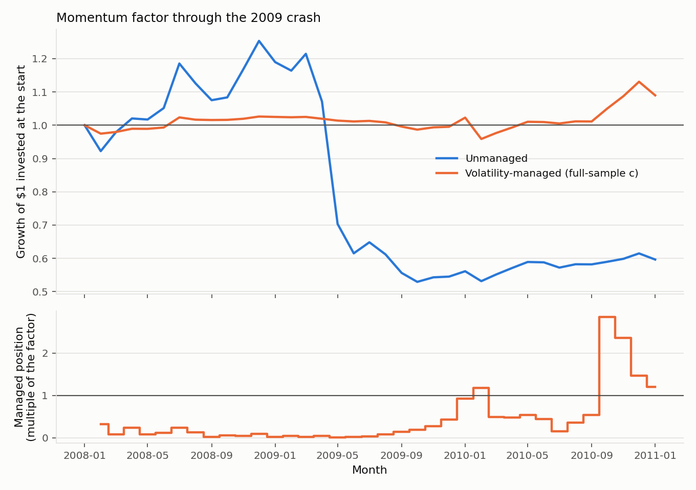

# Ballast

A well-known result, and the paper that says an investor could not have captured it. Both reproduced from public data.

## The result

Scaling a factor by the inverse of last month's variance earns a positive alpha in sample for five of six factors, and the alpha is statistically significant for the market, momentum and profitability. Run as a strategy that only uses data available at each date, the version that can use the managed factor has a lower Sharpe ratio than the plain factor for four of the six. Momentum is the exception: its gain survives in real time (+0.41 Sharpe, p < 0.01).


Bars are 95% intervals. Blue is each paper's own sample; orange extends the sample to September 2026, which neither paper covers.

<table>
<tr>
<th>In sample (1926-08 to 2015-04)</th>
<th>In real time (out of sample, 1936-08 to 2016-12)</th>
</tr>
<tr>
<td valign="top">

| Factor | Alpha (%/yr) | t | Appraisal ratio |
|---|---:|---:|---:|
| MKT | 4.93 | 3.15 | 0.33 |
| SMB | -0.59 | -0.64 | -0.07 |
| HML | 1.73 | 1.64 | 0.17 |
| MOM | 12.83 | 7.47 | 0.87 |
| RMW | 2.80 | 3.14 | 0.44 |
| CMA | 0.36 | 0.53 | 0.07 |

</td>
<td valign="top">

| Factor | Sharpe, with managed | Sharpe, unmanaged | Difference [p] | CER gain (%/yr) [p] |
|---|---:|---:|---:|---:|
| MKT | 0.42 | 0.46 | -0.04 [0.62] | -0.22 [0.81] |
| SMB | 0.13 | 0.19 | -0.06 [0.36] | -0.38 [0.26] |
| HML | 0.37 | 0.44 | -0.07 [0.33] | -0.24 [0.68] |
| MOM | 0.89 | 0.48 | +0.41 [0.00] | +5.67 [0.00] |
| RMW | 0.51 | 0.33 | +0.18 [0.38] | +1.61 [0.39] |
| CMA | 0.53 | 0.56 | -0.04 [0.14] | -0.38 [0.14] |

</td>
</tr>
</table>

The left table is Moreira and Muir's Table 1, Panel A: regress the managed factor on the unmanaged one, with White standard errors. MOM starts in 1927-01, RMW and CMA in 1963-08. The right table is Cederburg et al.'s Table 5, Panel A: a mean-variance investor (risk aversion 5, position capped at 5) estimates the scaling constant and the portfolio weights on an expanding window after 120 months of training. RMW and CMA are scored from 1973-08. CER is the certainty-equivalent return. The p-values are from the Jobson-Korkie test for Sharpe ratios and the DeMiguel-Garlappi-Uppal test for CERs.

Factor returns ignore trading costs, and rescaling a position every month is not free. See [Limits](#limits) for how much the position moves.

## How to reproduce

```
uv sync
uv run python scripts/fetch_data.py
uv run python scripts/reproduce.py
```

The last command rebuilds every table and figure in `results/` in about five seconds. `uv run python scripts/reproduce.py --fast` runs the same pipeline on seeded synthetic data, with no download, and writes to a temporary folder. CI uses it.

## What was built

- A parser for the French library's CSV files, and a fetch script that records the download time, checksums and the last month in each file.
- Moreira and Muir's volatility-managed factors: the factor return times `c` over last month's realized variance from daily returns, with `c` set so the managed and unmanaged series have the same variance.
- The spanning regression with White standard errors, written out and checked against statsmodels.
- Cederburg et al.'s real-time combination strategy, the ex post optimal strategy it is compared with, and both of their tests.
- The momentum factor through the 2009 crash, month by month.

## Sources

- Moreira and Muir, "Volatility-Managed Portfolios", Journal of Finance 72(4), 2017. Read as NBER working paper 22208.
- Cederburg, O'Doherty, Wang and Yan, "On the performance of volatility-managed portfolios", Journal of Financial Economics 138(1), 2020. Read in the published version.
- Daniel and Moskowitz, "Momentum crashes", Journal of Financial Economics 122(2), 2016. Read as NBER working paper 20439.

`PAPER.md` gives each formula with its equation number, and every printed cell next to ours.

## Comparison with the papers

Both papers replicate. Every sign matches except one cell the paper prints as 0.00 (ours is -0.03), every sample size matches exactly, and every 5% significance verdict in Cederburg et al.'s Table 5 matches. Most cells differ in the second decimal.

| Table | Cells compared | Differ after rounding | Largest gap |
|---|---:|---:|---|
| Moreira and Muir, Table 1, Panel A | 42 | 28 | RMW RMSE, 21.84 against 20.16 |
| Moreira and Muir, Table 1, Panel B | 12 | 9 | RMW alpha, 3.62 against 3.18 |
| Cederburg et al., Table 1 | 30 | 18 | HML p-value, 0.74 against 0.86 |
| Cederburg et al., Table 3, Panel A | 36 | 28 | RMW t-statistic, 2.90 against 2.57 |
| Cederburg et al., Table 5, Panel A | 60 | 48 | RMW real-time CER, 2.59 against 1.96 |

The likely reason is the data vintage. The French library is rebuilt with each CRSP update, and the files fetched here were built from the September 2026 CRSP database, not the 2015 and 2017 files the authors used. The profitability factor is the furthest off in four of the five tables, which fits a factor whose history has been revised. I could not test this, because the old files are not published.

## The extension, which is new

Neither paper covers data after 2016. Extending both exercises to September 2026 changes little: alphas of 4.51 (market) and 11.95 (momentum) in sample, and a real-time Sharpe gain of +0.40 for momentum against losses of 0.03 to 0.06 for the market, size, value and investment. The full tables are in `results/headline.md`.

The months after each paper's sample are the cleanest test, because nobody had seen them when the papers were written. Over May 2015 to September 2026 (137 months), no managed factor has a significant alpha. Three of the six are negative, and momentum's falls to 3.31% a year (t = 1.10). In real time over January 2017 to September 2026, momentum's Sharpe gain is +0.13 (p = 0.56). Eleven years is too short to conclude that the momentum result has gone, and it is also no confirmation.

## Momentum through 2009



From March to May 2009 the momentum factor lost 49.4%. The managed version lost 1.3%. In April 2009 the factor fell 34.4%; momentum's annualized volatility in March had been 54%, so the managed position was 0.016 of the factor. The real-time combination strategy lost 8.1% over the same three months, against 34.6% for the real-time investor holding only the plain factor.

| Series | March to May 2009 | 2008 to 2010 | Largest drawdown, 2008 to 2010 |
|---|---:|---:|---:|
| Unmanaged momentum | -49.4% | -40.4% | -57.8% |
| Managed, full-sample `c` | -1.3% | +9.0% | -6.6% |
| Real-time combination | -8.1% | +6.3% | -15.1% |
| Real-time unmanaged benchmark | -34.6% | -26.3% | -41.3% |

Daniel and Moskowitz document the crash with a winners-minus-losers decile portfolio, which fell 42.28% in March and 45.52% in April 2009 (their Table 2). The French momentum factor used here is built from a two-by-three sort and falls less.

Managing does not remove the left tail. It moves it to months that follow a calm one: the managed factor's worst month is June 1944, when the factor lost 5.8% while the position was 5.5.

## Data and its terms

Daily and monthly returns for the market, SMB, HML, momentum, RMW and CMA come from the [Kenneth R. French Data Library](https://mba.tuck.dartmouth.edu/pages/faculty/ken.french/data_library.html). The files are free and need no key. The page carries a copyright notice and states no licence, so none of the data is committed; `scripts/fetch_data.py` downloads it into `data/`, which git ignores.

The results here use files downloaded on 2026-11-23 (06:24 UTC). The last month in the data is September 2026. `results/data_vintage.json` holds the checksums. A later download will give slightly different numbers.

## How it is tested

`uv run pytest` runs 68 tests in about 30 seconds.

- The managed series has the same variance as the unmanaged one, for every factor and both variance definitions, to twelve digits.
- No real-time quantity uses later data. The test replaces every return after June 1960 with noise and checks that every position and return up to June 1960, and the position for July 1960, is unchanged to the last bit. A companion test shows the full-sample `c` does move.
- The regression code matches statsmodels for coefficients, classical, HC0 and HC1 standard errors, R², and the standard error of the regression.
- The parser is checked on two small files written by hand, including the missing-value codes, the annual block that follows the monthly one, and Windows line endings.
- The ex post optimal strategy satisfies the identities in Cederburg et al.'s equations (10), (13) and (14). Both difference tests match the formulas written out, and have about the right rejection rate on simulated data.
- Running the pipeline twice gives byte-identical tables and figures.
- With real data present, three tests compare against the printed tables: sample sizes exact, alphas within 0.50 percentage points a year, betas within 0.05, Sharpe ratios within 0.08 and CERs within 0.70. These are skipped in CI, which has no data. The tolerances were set after seeing the gaps above, so they guard against regressions and prove nothing about the match.

`uv run ruff check .` and `uv run mypy src` are clean.

## Layout

```
src/ballast/           the code
tests/                 maths tests first
scripts/reproduce.py   one command rebuilds every figure and table
scripts/fetch_data.py  downloads public data into data/ (never committed)
results/               committed figures and small tables
PAPER.md               citations, formulas, comparison with the sources
```

## Roadmap

- [x] Project skeleton, CI, and the reproduce command
- [x] Moreira and Muir's volatility-scaled factors and their alphas
- [x] The real-time version from Cederburg, O'Doherty, Wang and Yan, where the scaling uses only past data
- [x] Momentum crashes as the worked example
- [x] `PAPER.md` comparison with the sources
- [x] Results and limits written up at the top of this file

## Limits

- Factor returns ignore trading costs. Scaling exposure every month is not free. Over 1926 to 2026 the managed position has a median between 0.66 and 0.99 of the factor and a 99th percentile between 5.0 and 8.1, and it changes by 0.53 to 0.90 of the factor's notional in an average month. The momentum position peaks at 21 times the factor in October 1994. No cost is charged for any of this, and the factors themselves are long-short portfolios with their own turnover and shorting costs. Net results would be worse than every number here.
- Only six of Moreira and Muir's nine factors are covered. The q-factors, betting-against-beta and currency carry are not in the French library. Cederburg et al.'s 94 anomaly portfolios need CRSP and Compustat and are not here either, so their broad-sample conclusion (Tables 2, 4 and 6) is not tested.
- The real-time result depends on a design: 120 months of training, an expanding window, risk aversion of 5 and a position cap of 5. These are the paper's base case. Its robustness table (Table 7) and the version with the three Fama-French factors in the portfolio (Table 5, Panel B) are not reproduced.
- The data are today's vintage, so the paper-sample numbers are a replication on revised data. The gaps are listed, and their cause is a guess.
- Moreira and Muir's sample end is inferred. The paper says 1926 to 2015; April 2015 is the month that reproduces all six of its sample sizes.
- The sample runs past both papers. Results on the extra years are new and are marked as such. The post-sample window is 117 to 137 months, which is short for a Sharpe-ratio comparison.
- Two of the papers were read as working papers, so table and equation numbers may differ from the journal versions.
- This is research code. It is not investment advice and it does not trade.

## The name

Ballast is weight a ship takes on or sheds to stay level. Volatility management does that with risk.

## Licence

MIT. See `LICENSE`.
